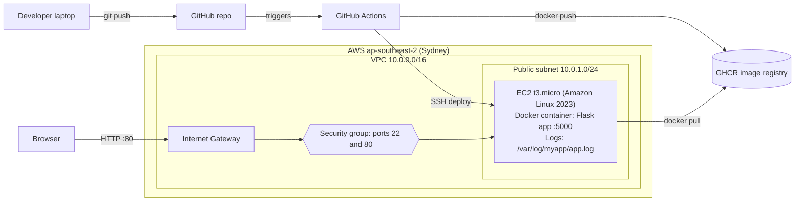

# Automated AWS Cloud Infrastructure & CI/CD Deployment

A small Flask web app deployed to AWS EC2 with **Terraform** (infrastructure as code), packaged in **Docker**, and redeployed automatically by **GitHub Actions** on every push to `main`.

## What this project does

- Provisions a VPC, public subnet, internet gateway, route table, security group, SSH key pair and an EC2 instance with Terraform.
- Runs a Python Flask app (with a `/health` endpoint) inside a Docker container on that instance.
- Builds the Docker image, pushes it to GitHub Container Registry (GHCR) and redeploys it to EC2 over SSH on each push.
- Writes application logs to a file on the instance.

## Architecture



## Repository layout

```
.
├── .github/workflows/deploy.yml   # CI/CD pipeline
├── app/
│   ├── app.py                     # Flask app with / and /health
│   ├── Dockerfile
│   ├── requirements.txt
│   └── .dockerignore
└── infra/
    └── main.tf                    # Terraform infrastructure
```

## Prerequisites

- An AWS account and an IAM user with programmatic access (access key configured with `aws configure`)
- [Terraform](https://developer.hashicorp.com/terraform/install), [AWS CLI](https://aws.amazon.com/cli/) and Git installed
- A GitHub account

## Steps to deploy the infrastructure

1. **Create an SSH key** (the private key stays on your machine and is never committed):
   ```powershell
   ssh-keygen -t ed25519 -f "$HOME\.ssh\assignment-key"
   ```
2. **Configure AWS credentials:** `aws configure` (region `ap-southeast-2`). Verify with `aws sts get-caller-identity`.
3. **Run Terraform:**
   ```powershell
   cd infra
   terraform init
   terraform plan
   terraform apply
   ```
4. Note the outputs: `public_ip` and `ssh_command`.
5. Wait about two minutes for the instance to finish booting (Docker is installed by the `user_data` script).

To remove everything: `terraform destroy`.

## Steps to trigger a deployment

1. In the GitHub repo, go to **Settings → Secrets and variables → Actions** and add:

   | Secret | Value |
   |---|---|
   | `EC2_HOST` | The instance public IP from `terraform output public_ip` |
   | `EC2_SSH_KEY` | Contents of the private key file `~/.ssh/assignment-key` |

2. Push any change to the `main` branch:
   ```powershell
   git add .
   git commit -m "my change"
   git push
   ```
3. Open the **Actions** tab and watch the workflow: log in to GHCR, build and push the image, deploy to EC2, health check.
4. Open `http://<EC2_HOST>` and `http://<EC2_HOST>/health` in a browser.

> If the instance is destroyed and recreated, it gets a new public IP. Update the `EC2_HOST` secret and re-run the workflow.

## CI/CD pipeline

`.github/workflows/deploy.yml` runs on every push to `main`:

1. Checks out the code.
2. Logs in to GHCR with the automatically generated `GITHUB_TOKEN`.
3. Builds the Docker image from `./app` and pushes it to GHCR.
4. Connects to EC2 over SSH, pulls the new image, replaces the running container and mounts `/var/log/myapp` for logs.
5. Calls `/health` and fails the run if the app does not respond.

## Security basics

| Requirement | How it is met |
|---|---|
| No hardcoded secrets | SSH key and host IP live in GitHub Secrets. The registry login uses the per-run `GITHUB_TOKEN`. Terraform reads the public key from disk, and `.gitignore` excludes state files, `.terraform/` and key files. |
| SSH key authentication | The instance has no password login. Only the public key is uploaded to AWS (`aws_key_pair`). |
| Minimal open ports | The security group allows only 80 (HTTP) and 22 (SSH). |
| Extra hardening | The instance requires IMDSv2 (`http_tokens = "required"`). |

**Trade-off:** SSH (port 22) is open to `0.0.0.0/0` because GitHub Actions runners use changing IP addresses. Access is protected by key-only login. In production I would use AWS Systems Manager Session Manager or self-hosted runners with a fixed IP.

## Logging

The app writes timestamped logs to the console and to `/logs/app.log` inside the container. That folder is mounted from `/var/log/myapp` on the EC2 instance, so logs survive redeploys.

```bash
sudo tail -n 20 /var/log/myapp/app.log
docker logs myapp
```

*(Add a screenshot of the log output here.)*

## Estimated AWS cost per day

Approximate on-demand prices for `ap-southeast-2` (Sydney). Check the [AWS Pricing Calculator](https://calculator.aws/) for current rates.

| Resource | Approx. cost per day |
|---|---|
| EC2 `t3.micro` (24 h) | about $0.32 |
| Public IPv4 address (24 h) | about $0.12 |
| EBS volume, 8 GB gp3 | about $0.03 |
| Data transfer | negligible for this demo |
| VPC, subnet, internet gateway, route table, security group | free |
| **Total** | **about $0.45 per day (about $14 per month)** |

Costs stop when the infrastructure is removed with `terraform destroy`.

## The journey: how it was built

1. **Account setup:** created an IAM user for Terraform and configured the AWS CLI on Windows.
2. **First Terraform run failed** with `ec2:CreateVpc ... explicit deny in a service control policy` in `ap-south-1`. The AWS free-plan account sits under an organization policy that restricts regions. Switching the provider to `ap-southeast-2` (Sydney) fixed it.
3. **Built the network step by step:** VPC, then subnet, internet gateway and route table, checked in the console resource map.
4. **Added the key pair, security group and EC2 instance.** A `user_data` script installs and starts Docker at first boot.
5. **Wrote the Flask app and Dockerfile**, copied them to the server with `scp` and ran the container by hand first to understand each step. A nested `app/app` folder caused a "Dockerfile not found" error until the files were moved up one level.
6. **Pushed to GitHub:** authentication failed because GitHub no longer accepts passwords for Git, so I signed in with the GitHub CLI (`gh auth login`).
7. **Built the CI/CD pipeline:** added the secrets, re-ran the workflow, and confirmed a code change reached the live site.
8. **Rebuilt the server and hit a stale IP:** a new instance gets a new public IP, so the `EC2_HOST` secret had to be updated. An Elastic IP would remove this step.
9. **Added file logging** and verified the log file on the instance.

## Possible improvements

- Attach an Elastic IP so the address survives rebuilds
- Remote Terraform state (S3 + DynamoDB locking)
- CloudWatch Logs with the CloudWatch agent
- HTTPS with a domain and a load balancer
- Replace open SSH with AWS Systems Manager Session Manager

## Demo

*(Add the demo video link here.)*
